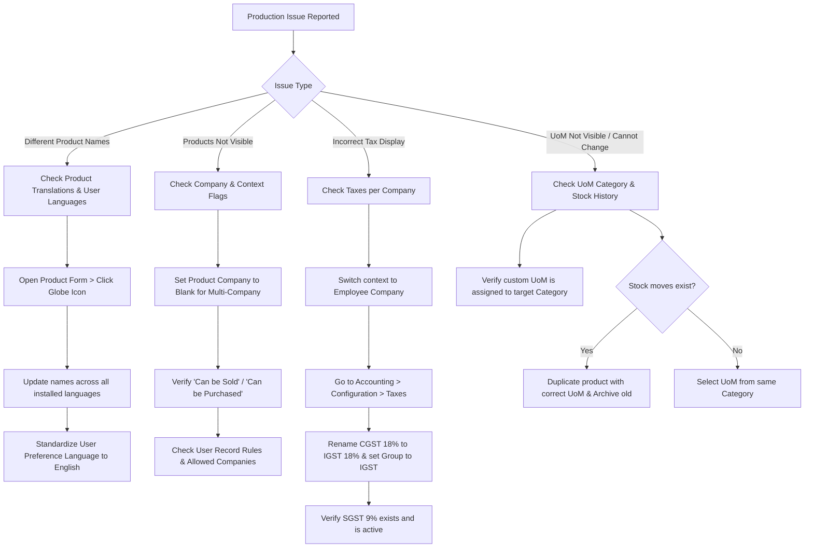

# Production Fix Guide: Product Naming, Visibility, GST Taxes & Unit of Measure (UoM)

> [!IMPORTANT]
> This guide outlines root causes, step-by-step resolution procedures, and verification checklists for resolving production issues in Odoo 18 involving product names, visibility, Indian GST taxes, and Unit of Measure (UoM) management.

---

## 📋 Quick Triage Matrix

| Issue | Symptoms | Primary Root Cause | Fast Resolution |
| :--- | :--- | :--- | :--- |
| **1. Product Name Mismatch** | Name updated by Admin shows on Admin profile but old name shows on employee profiles | Multi-language translation mismatch (`translate=True`) on `product.template.name` or browser cache | Update product name across all installed languages using the globe icon; standardize user language preferences |
| **2. Product Invisibility** | Products visible to Admin are missing from employee views/catalogs | Multi-company assignment (`company_id`), uncheck on `sale_ok`/`purchase_ok`, or record rules | Clear `company_id` on product form for global access; ensure `Can be Sold` / `Can be Purchased` are checked |
| **3. Tax Display Anomaly** | Employees see two CGST options (18% and 9%) instead of IGST 18%, SGST 9%, CGST 9% | Multi-company tax misconfiguration in branch company or misnamed tax / tax group in Indian GST | Switch to employee's company; rename `CGST 18%` to `IGST 18%` with group `IGST`; check `SGST 9%` |
| **4. UoM Selection & Editing Locked** | Only 2 UoMs appear in dropdown; unable to change Unit on existing product form | 1. UoMs belong to different **Categories** (Odoo filters dropdown strictly by active UoM Category).<br>2. Product has **existing stock moves / transactions**, locking base `uom_id` | 1. Assign custom UoMs to the target **UoM Category** (e.g., `Unit`).<br>2. Duplicate/recreate the product with the correct UoM and archive the old product. |

---



---

# Detailed Issue Analysis & Resolution

---

## Issue 1: Product Name Discrepancy Across User Profiles

### 1.1 Technical Root Cause
In Odoo, the `name` field on `product.template` is configured with `translate=True`.
- In Odoo 16+, translated values are stored as JSONB key-value pairs (e.g., `{"en_US": "Updated Name", "en_GB": "Old Name", "hi_IN": "Old Name"}`).
- When the Administrator modifies a product name, the update is saved under the **Administrator's current active language** (e.g., `en_US`).
- If an employee has a different language assigned in their user profile (e.g., `en_GB`, `en_IN`, or another dialect), Odoo renders the fallback or previously saved value for that specific language code.
- Client-side browser caches / OWL component storage can also temporarily serve cached strings until refreshed.

### 1.2 Step-by-Step UI Fix Procedure

#### Step 1: Synchronize Translations on Product Master
1. Navigate to **Inventory** (or **Sales**) > **Products** > **Products**.
2. Open the affected product record.
3. Look directly at the **Product Name** input box.
4. Click the **Language / Translation icon** (globe icon or language tag like `EN`) next to the name.
5. In the translation popup dialog:
   - Review each listed language (e.g., `English (US)`, `English (UK)`, `English (IN)`).
   - Enter the correct, updated product name for all active language lines.
   - Click **Save**.

#### Step 2: Standardize User Languages Across All Profiles
1. Go to **Settings** > **Users & Companies** > **Users**.
2. Select the employee user accounts.
3. Under the **Preferences** tab:
   - Check the **Language** field.
   - Standardize all internal staff to the same primary language (e.g., `English (US)` or `English (IN)`).
   - Click **Save**.

#### Step 3: Deactivate Unused Languages (Recommended)
1. Go to **Settings** > **Translations** > **Languages**.
2. If multiple variants of English or unused languages are installed, toggle their **Active** switch to `False` to prevent future translation fragmentation.

#### Step 4: Clear Client Browser Cache
Instruct all affected users to perform a clean browser reload:
- **Windows / Linux**: `Ctrl + F5` or `Ctrl + Shift + R`
- **macOS**: `Cmd + Shift + R`

---

## Issue 2: Products Not Visible in Employees' Profiles

### 2.1 Technical Root Causes
1. **Multi-Company Filtering (`company_id`):** When a product has a specific company assigned, users who do not have that company selected in their session cannot view the record. The Administrator typically has global company access (`SUPERUSER_ID`), which bypasses record rules.
2. **Sales & Purchase Domain Filters:**
   - Sales Order lines & Product Catalog use: `[('sale_ok', '=', True)]`.
   - Purchase Order lines & Material Indent use: `[('purchase_ok', '=', True)]`.
   - If these checkboxes are disabled, products do not appear in document selection menus.
3. **Record Rules (`ir.rule`):** Security rules filtering products by Category (`categ_id`), Location (e.g., custom `user_access_management`), or departmental groups restrict employees while Admin has root access.
4. **Archived Products:** Inactive products (`active = False`) are hidden unless the "Archived" filter is explicitly selected.

### 2.2 Step-by-Step UI Fix Procedure

#### Step 1: Set Multi-Company Access to Global
1. Log in as **Administrator**.
2. Go to **Inventory** > **Products** > **Products**.
3. Open the missing product.
4. Under the **General Information** tab:
   - Check the **Company** field.
   - **Fix:** If the product should be used across all companies/branches, **clear the Company field (leave it blank)**.
   - If the product must belong to a specific company, ensure the employee is assigned to that company in **Settings > Users & Companies > Users > Access Rights > Allowed Companies**.

#### Step 2: Enable Sales & Purchase Flags
1. On the product form, ensure the following checkboxes are enabled as required:
   - ✅ **Can be Sold** (Required for Sales Quotations & Invoices)
   - ✅ **Can be Purchased** (Required for Purchase Orders, RFQs & Material Indents)
2. Save the record.

#### Step 3: Check Product Category & Security Groups
1. Go to **Inventory** > **Configuration** > **Product Categories**.
2. Verify the category assigned to the product.
3. Ensure no restricted record rules or internal access restrictions prevent standard users from reading records in that category.

---

## Issue 3: Tax Display & Configuration Discrepancy (CGST 18% & 9% vs IGST, SGST, CGST)

### 3.1 Technical Root Causes
Under Indian GST localization (`l10n_in`):
1. **Company-Specific Taxes (`account.tax`):** Taxes belong to individual companies (`company_id`).
   - The Administrator was viewing records under Company 1 (where standard GST taxes exist: `CGST 9%`, `SGST 9%`, `IGST 18%`).
   - The employees were operating under Company 2 (Branch / Subsidiary), where taxes were incorrectly created or renamed:
     - An 18% tax was misnamed **"CGST 18%"** instead of **"IGST 18%"**.
     - An **SGST 9%** tax was either missing or misnamed as a second **"CGST 9%"**.
2. **Tax Group Assignment:** If a tax has its **Tax Group** set to `CGST` instead of `IGST` or `SGST`, the UI groupings and report summaries display incorrect tax headers.
3. **Tax Name Translation Overwrite:** If a tax was renamed while a specific language was active, users in other profiles will see the translated label.
4. **Fiscal Position Mapping (`account.fiscal.position`):** An incorrectly configured fiscal position might be mapping taxes to duplicate CGST lines on sales/purchase lines.

### 3.2 Step-by-Step UI Fix Procedure

#### Step 1: Switch to the Employee's Company Context
1. In the top-right header of Odoo, click the company selector.
2. Select the **Employee's Company / Branch**.

#### Step 2: Correct the Tax Master Configuration
1. Go to **Accounting** (or **Invoicing**) > **Configuration** > **Taxes**.
2. Filter by **Company** = Current Company.
3. Identify and correct the misconfigured taxes:

##### A. Correcting the 18% Tax:
- Open the tax currently titled **"CGST 18%"**.
- Update **Tax Name**: `IGST 18%` (or `GST 18% - Inter State`).
- Set **Tax Computation**: `Percentage of Price`.
- Set **Amount**: `18.0000%`.
- Set **Tax Group**: `IGST` (Create or select the standard IGST group).
- Set **Tax Scope**: `Sales` or `Purchases` as appropriate.
- Click the **Translation Icon** on the Tax Name and verify all language entries read `IGST 18%`.
- Save the tax.

##### B. Correcting the 9% Taxes (Intra-State Pair):
- Verify you have two distinct 9% taxes for Intra-state transactions:
  1. **Tax 1:** Name = `CGST 9%`, Amount = `9.0000%`, Tax Group = `CGST`.
  2. **Tax 2:** Name = `SGST 9%`, Amount = `9.0000%`, Tax Group = `SGST`.
- If the second 9% tax is named `CGST 9%`, edit it and rename to **`SGST 9%`** with Tax Group **`SGST`**.

#### Step 3: Verify Fiscal Positions
1. Go to **Accounting** > **Configuration** > **Fiscal Positions**.
2. Open **Intra-State GST** and **Inter-State GST**.
3. Under the **Tax Mapping** tab:
   - For **Intra-State**: Verify source tax maps to `CGST 9%` + `SGST 9%`.
   - For **Inter-State**: Verify source tax maps to `IGST 18%`.

---

## Issue 4: UoM Visibility & Product Unit Modification Locked

### 4.1 Technical Root Causes

#### A. Why only 2 UoMs are visible in the dropdown:
- In Odoo, every Unit of Measure belongs to a **UoM Category** (`uom.category`), such as *Unit*, *Weight*, *Volume*, *Length/Distance*, *Working Time*.
- When you click the **Unit of Measure** or **Purchase Unit of Measure** field on a product, Odoo applies a strict domain constraint: **only UoMs belonging to the exact same UoM Category as the current unit are displayed**.
- Default Odoo data in the `Unit` category includes only **`Units`** and **`Dozens`** (exactly **2** UoMs).
- Any newly created UoMs that were placed under different categories (e.g., *Weight*, *Length*, or a custom category) will **never appear** in the `Unit` dropdown.

#### B. Why you are unable to change the Unit on an existing Product:
- Odoo enforces a core protection rule in `stock/models/product.py`:
  ```python
  done_moves = self.env['stock.move'].sudo().search([
      ('product_id', 'in', self.mapped('product_variant_ids').ids)
  ], limit=1)
  if done_moves:
      raise UserError(_("You cannot change the unit of measure as there are already stock moves for this product. If you want to change the unit of measure, you should rather archive this product and create a new one."))
  ```
- As soon as a product has **any stock moves** (e.g. inventory adjustments, receipts, internal transfers, delivery orders, or sales/purchase allocations), Odoo **locks the base `uom_id`** to prevent catastrophic inventory valuation and ledger corruption.

---

### 4.2 Step-by-Step UI Fix Procedure

#### Part 1: Making New UoMs Available in the Dropdown
If your custom UoM is not appearing in the dropdown:
1. Go to **Inventory** (or **Sales**) > **Configuration** > **Units of Measure** > **Units of Measure**.
2. Locate the custom UoM you created (e.g., `Nos`, `Pcs`, `Box`, `Pack of 10`).
3. Open it and check the **Category** field:
   - If the product uses a unit-based measurement, change the **Category** to **`Unit`**.
   - Set the **Ratio / Type**:
     - *Bigger than the reference Unit of Measure* (e.g., `Box of 10` = 10.0)
     - *Smaller than the reference Unit of Measure*
     - *Reference Unit of Measure for this category* (if it is the base 1.0 unit)
4. Save the UoM.
5. Return to the product form; your new UoM will now appear in the dropdown.

#### Part 2: Changing the Unit of Measure on a Locked Product

##### Option A: Standard Odoo Production Method (Recommended & Safe)
If the product already has transactions/stock history:
1. Go to **Inventory** > **Products** > **Products**.
2. Open the locked product.
3. Click the **Action (⚙️ Gear icon)** at the top > **Duplicate**.
4. On the new duplicated product:
   - Select your desired **Unit of Measure** and **Purchase Unit of Measure** (since it has no stock history yet, the fields are fully editable).
   - Adjust the Internal Reference / SKU if needed.
   - Click **Save**.
5. Go back to the old product:
   - Click **Action** > **Archive** (this prevents staff from selecting the old unit in new orders while preserving historical ledger accuracy).

##### Option B: Unlocking if the Product has Only Draft / Inactive Transactions
If the product was newly created during testing:
1. Check if open draft transfer lines, RFQs, or unposted stock scrap exist for the product.
2. Cancel or delete the draft stock moves / inventory adjustments.
3. Once all stock moves for the product variants are zero/deleted, the `uom_id` field will become editable again.

---

## 🛠️ Post-Fix Validation Checklist

Execute this checklist in production to confirm full resolution:

- [ ] **Test 1 (Product Names):** Log in as an Employee. Open the product list and product forms. Confirm the name matches what the Administrator sees.
- [ ] **Test 2 (Product Search):** Create a test Sales Quotation and Material Indent as an Employee. Search for the previously missing products and verify they appear immediately in autocomplete.
- [ ] **Test 3 (Tax Selection on Sales/Purchase Order):**
  - Create a new Sales Order / Purchase Order as an Employee.
  - Add a product line and open the **Taxes** dropdown.
  - Confirm options display as `IGST 18%`, `CGST 9%`, and `SGST 9%`.
  - Add `CGST 9%` + `SGST 9%` and verify the subtotal tax breakdown lists both CGST and SGST correctly.
  - Add `IGST 18%` and verify the subtotal tax breakdown lists IGST correctly.
- [ ] **Test 4 (UoM Dropdown & Category Check):**
  - Open **Inventory > Configuration > Units of Measure**.
  - Confirm custom units (e.g. `Pcs`, `Box`) have Category set to `Unit`.
  - Open a new product form and verify all category UoMs appear in the dropdown.
- [ ] **Test 5 (Multi-Company Context):** Switch between parent company and branch companies; verify taxes and products remain consistent according to company allocation rules.
